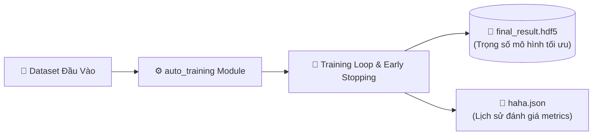

<div align="center">

# ⚙️ AUTO-TRAINING LIBRARY ⚙️
### 🤖 Automated Deep Learning Pipeline, Hyperparameter Search & Model Checkpointing
*Thư Viện Tự Động Hoá Huấn Luyện Mô Hình Học Sâu & Lưu Trữ Trọng Số Tối Ưu*

[](https://python.org)
[](https://www.hdfgroup.org/)
[](https://github.com/baolam/autotraininglib)

---

</div>

> [!IMPORTANT]
> **Auto-Training Library** là công cụ giúp chuẩn hoá và tự động hoá toàn bộ chu trình huấn luyện mô hình học sâu: từ tiền xử lý dữ liệu, tìm kiếm siêu tham số, dừng sớm (Early Stopping) đến lưu trữ trọng số tối ưu nhất ở định dạng chuẩn **HDF5** (`final_result.hdf5`).

---

## 📑 Mục Lục (Table of Contents)
- [✨ Tính Năng Nổi Bật](#-tính-năng-nổi-bật)
- [🏗️ Luồng Tự Động Huấn Luyện](#️-luồng-tự-động-huấn-luyện)
- [📂 Cấu Trúc Dự Án](#-cấu-trúc-dự-án)
- [⚙️ Công Nghệ Sử Dụng](#️-công-nghệ-sử-dụng)
- [🚀 Hướng Dẫn Sử Dụng](#-hướng-dẫn-sử-dụng)
- [📜 Giấy Phép (License)](#-giấy-phép-license)

---

## ✨ Tính Năng Nổi Bật

| Biểu Tượng | Tính Năng | Mô Tả Chi Tiết |
| :---: | :--- | :--- |
| 🔄 | **Quy Trình Tự Động Hoá Khép Kín** | Tự động phân chia train/val/test, lặp qua các epoch và theo dõi giá trị hàm mất mát. |
| 💾 | **Lưu Trữ Trọng Số Chuẩn HDF5** | Tự động xuất checkpoint mô hình tốt nhất (`final_result.hdf5`) để phục vụ deployment trực tiếp. |
| 📊 | **Báo Cáo Tiến Trình Định Dạng JSON** | Ghi nhận chi tiết lịch sử học tập và siêu tham số vào file nhật ký (`haha.json`). |

---

## 🏗️ Luồng Tự Động Huấn Luyện



---

## 📂 Cấu Trúc Dự Án

```bash
autotraininglib/
├── 📄 index.py                # Điểm khởi chạy quy trình tự động huấn luyện
├── 📂 auto_training/          # Thư viện lõi chứa các bộ điều phối huấn luyện
├── 📦 final_result.hdf5       # File trọng số mô hình đã huấn luyện hoàn chỉnh
├── 📄 haha.json               # Nhật ký ghi nhận các chỉ số trong quá trình train
└── 📄 README.md               # Hướng dẫn sử dụng thư viện
```

---

## ⚙️ Công Nghệ Sử Dụng

- **Deep Learning Core**: Python, Keras / TensorFlow, PyTorch
- **Model Serialization**: H5py, HDF5
- **Configuration & Logging**: JSON

---

## 🚀 Hướng Dẫn Sử Dụng

```bash
# 1. Clone repository
git clone https://github.com/baolam/autotraininglib.git
cd autotraininglib

# 2. Cài đặt các gói phụ thuộc
pip install h5py numpy tensorflow

# 3. Chạy quy trình tự động huấn luyện
python index.py
```

---

<div align="center">

## 📜 Giấy Phép (License)

Dự án được phân phối dưới giấy phép **MIT License**.

---
**Made with ❤️ by [Bảo Lâm](https://github.com/baolam)**

</div>
